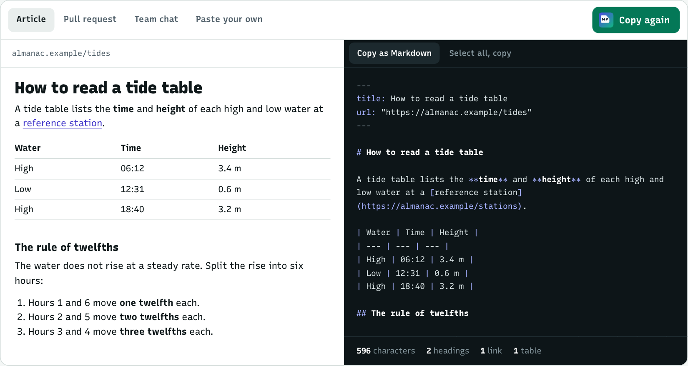

<p align="center">
  
</p>

<h1 align="center">Copy as Markdown</h1>

<p align="center"><strong>Copy the page. Leave the mess.</strong></p>

<p align="center">
  One click turns the web page you are on into clean Markdown on your clipboard.<br>
  Paste it into ChatGPT, Claude, Gemini, your notes, or your docs.
</p>

<p align="center">
  <a href="https://chromewebstore.google.com/detail/copy-as-markdown/pcjanmkidppaeojkanbjbmmgpjfeecol"><b>Chrome</b></a> ·
  <a href="https://addons.mozilla.org/en-US/firefox/addon/copy-as-markdown-addon/"><b>Firefox</b></a> ·
  <a href="https://github.com/bvolpato/copy-as-markdown/releases/latest/download/copy-as-markdown.user.js"><b>Userscript</b></a> ·
  <a href="https://bvolpato.github.io/copy-as-markdown/">Try the live demo</a> ·
  <a href="#library">Library</a>
</p>

<p align="center">
  <a href="https://bvolpato.github.io/copy-as-markdown/">
    <picture>
      <source media="(prefers-color-scheme: dark)" srcset="https://raw.githubusercontent.com/bvolpato/copy-as-markdown/main/docs/screenshots/demo-dark.png">
      
    </picture>
  </a>
</p>

## Install

| | Get it | Where the button is |
| --- | --- | --- |
| **Chrome, Brave, Edge, Chromium** | [Chrome Web Store](https://chromewebstore.google.com/detail/copy-as-markdown/pcjanmkidppaeojkanbjbmmgpjfeecol) | Browser toolbar |
| **Firefox** | [Firefox Add-ons](https://addons.mozilla.org/en-US/firefox/addon/copy-as-markdown-addon/) | Browser toolbar |
| **Any browser with [Tampermonkey](https://www.tampermonkey.net/) or [Violentmonkey](https://violentmonkey.github.io/)** | [Userscript](https://github.com/bvolpato/copy-as-markdown/releases/latest/download/copy-as-markdown.user.js) | On the page |

It is free and open source. You do not need an account.

## Use it

1. Open a page. If you want only a part of it, select that part.
2. Click the toolbar icon, or press <kbd>Alt</kbd>+<kbd>Shift</kbd>+<kbd>M</kbd>. With the userscript, click the button on the page.
3. Paste.

The toolbar icon shows `…` while it copies, `✓` when the copy is done, and `!` when the page or the clipboard is not available.

In Datadog dashboards, Datadog notebooks, and W&B runs, the extension also puts a button on the page. You can drag a floating userscript button to a better place. Its position is saved for each site.

## What you get

This is the start of a copied Hacker News thread. The output is shortened here.

```markdown
---
title: "My YC app: Dropbox - Throw away your USB drive"
url: "https://news.ycombinator.com/item?id=8863"
---

# My YC app: Dropbox - Throw away your USB drive

**Link:** http://www.getdropbox.com/u/2/screencast.html
**Score:** 104 points
**Author:** dhouston
**Posted:** on April 4, 2007

## Comments (71)

- **BrandonM** (on April 5, 2007):
  I have a few qualms with this app:

  1. For a Linux user, you can already build such a system yourself quite trivially...
```

| Part of the page | In the Markdown |
| --- | --- |
| Title, URL, and details that the body does not repeat | YAML front matter |
| Headings | `#` to `######`, with the same hierarchy |
| Tables and infoboxes | Pipe tables |
| Code | Fenced blocks with the language, character for character |
| Links and images | Absolute URLs |
| Comments and replies | Nested lists with their depth |
| Menus, ads, banners, sidebars | Left out |

In prose, the converter normalizes smart quotes, unusual spaces, and dashes, and it removes invisible watermark and direction-control characters. Code keeps its literal text.

### Why Markdown

Language models read structure better than loose text, and Markdown keeps the structure with few characters. On these pages, the copy is 2% to 28% of the size of the HTML:

| Page | HTML | Markdown | Size |
| --- | --- | --- | --- |
| [Wikipedia article](https://en.wikipedia.org/wiki/Markdown) | 525,371 | 36,537 | 7% |
| [GitHub issue thread](https://github.com/microsoft/TypeScript/issues/9998) | 936,857 | 36,820 | 4% |
| [PyPI package](https://pypi.org/project/requests/) | 353,729 | 8,906 | 3% |
| [Guardian article](https://www.theguardian.com/commentisfree/2022/jul/15/the-guardian-view-on-the-james-webb-telescope-a-window-on-the-unknown) | 342,150 | 5,534 | 2% |
| [MDN reference page](https://developer.mozilla.org/en-US/docs/Web/JavaScript/Reference/Global_Objects/Array/map) | 88,961 | 12,599 | 14% |
| [arXiv paper](https://arxiv.org/html/1706.03762v7) | 188,288 | 40,020 | 21% |
| [Hacker News thread](https://news.ycombinator.com/item?id=8863) | 101,315 | 28,549 | 28% |

Sizes are in characters. HTML is the page after it loads, which can be larger or smaller than the download. They were measured on November 26, 2026 in a headless browser, signed out.

## Supported sites

Copy as Markdown has its own extractor for <!-- count -->97<!-- /count --> sites and platforms. See [what each one copies](https://github.com/bvolpato/copy-as-markdown/blob/main/SUPPORTED_SITES.md).

<!-- sites:start -->

| Category | Sites |
| --- | --- |
| **AI assistants** | ChatGPT, Claude, Gemini, Gemini Notebook / NotebookLM, Google AI Studio, Perplexity, Grok, Meta AI, Microsoft Copilot, Mistral Vibe / Le Chat, DeepSeek |
| **AI models and experiments** | Hugging Face, OpenRouter, Artificial Analysis, DeepSWE, Weights & Biases, MLflow, LeetLLM |
| **Code and packages** | GitHub, GitLab, Bitbucket, Codeberg / Gitea / Forgejo, npm, PyPI, crates.io, pkg.go.dev, RubyGems, Docker Hub |
| **Documentation and reference** | Documentation frameworks, MDN Web Docs, Datadog Documentation, OpenAPI docs, Wikipedia, MediaWiki, Grokipedia |
| **Work and documents** | Google Docs, Google Sheets, Google Slides, Gmail, Outlook on the web, Notion, Linear, Jira, Confluence, Microsoft 365 |
| **Chat and communities** | Slack, Microsoft Teams, Discord, WhatsApp Web, Reddit, Hacker News, Lobsters, Stack Overflow / Stack Exchange, Discourse |
| **Observability** | Datadog dashboards, Datadog notebooks, Grafana, Sentry |
| **Search engines** | Google Search, Bing, DuckDuckGo, Brave Search, Yahoo Search, Yandex Search, Baidu Search |
| **Research, filings, and markets** | arXiv, OpenReview, PubMed / PMC, Semantic Scholar, Google Scholar, SEC EDGAR, Polymarket, Kalshi |
| **Social, video, and entertainment** | YouTube, X (Twitter), Bluesky, Mastodon, LinkedIn, Facebook, Instagram, TikTok, Pinterest, VK, Twitch, Netflix, IMDb, FOX |
| **News and publishing** | News sites, Globo, Medium, Substack, DEV Community, Ghost / Obsidian Publish |
| **Shopping, travel, and weather** | Amazon, Temu, Booking.com, Weather.com |

<!-- sites:end -->

On every other site, the general extractor finds the main content.

### Limits

- A copy contains what the page has loaded. Scroll to older messages and expand collapsed sections first. Copies of AI chats say when older messages were not loaded. Other chat apps do not say it.
- It does not get around logins or paywalls. Pages that need a login use the session that you already have in the browser.
- Content that a site draws on a canvas can be missing.
- W&B and MLflow metric histories are sampled, so that the copy stays small. [Details](https://github.com/bvolpato/copy-as-markdown/blob/main/SUPPORTED_SITES.md#metric-histories).

## Privacy

The conversion runs in your browser, and the result goes to your clipboard. There are no analytics, no ads, and no server.

Some pages that need a login are read through that site's own HTTPS API, with your existing session. Page content does not go to the developer or to unrelated third parties. Read the [privacy policy](https://bvolpato.github.io/copy-as-markdown/privacy.html).

| Permission | Why |
| --- | --- |
| `activeTab` | Read the current page after you click |
| `scripting` | Run the packaged extraction script in that tab |
| `clipboardWrite` | Write the Markdown to your clipboard |
| Access to Datadog dashboards, Datadog notebooks, and W&B runs | Show a button on the page |

## Troubleshooting

**Chrome shows "Wants access to this site".** Click **Allow**, and then click the icon again. The extension has no standing access to most sites.

**The userscript does nothing in Chrome, Brave, or Edge.** Open the settings of the userscript manager extension and enable **Allow User Scripts**. As an alternative, enable **Developer mode**. See [the Tampermonkey instructions](https://www.tampermonkey.net/faq.php?q=Q209).

**The keyboard shortcut does nothing.** Another extension can own the same keys. Open `chrome://extensions/shortcuts`, or **Manage Extension Shortcuts** in Firefox, and set it again.

**The output is wrong.** [Open an issue](https://github.com/bvolpato/copy-as-markdown/issues) with the URL, the browser, and the result that you expected.

## Library

The same extractors are available as an ESM package. The package has no runtime dependencies. It does not change the page, write to the clipboard, or use extension APIs.

```bash
pnpm add @bvolpato/copy-as-markdown
```

```typescript
import { createExtractorMatcher, htmlToMarkdown, loadExtractors } from '@bvolpato/copy-as-markdown';

// Convert HTML that you already have.
const markdown = htmlToMarkdown('<article><h1>Hello</h1></article>');

// Or use site extractors in a content script.
const extractors = await loadExtractors(['github', 'jira', 'google-docs']);
const match = createExtractorMatcher({ extractors }).match({ url: location.href, document });
if (match) await navigator.clipboard.writeText(await match.extract());
```

The [library guide](https://github.com/bvolpato/copy-as-markdown/blob/main/LIBRARY.md) covers domain restrictions, custom extractors, and bundling.

### Your site already has a copy button

Give any element the ID `copy_as_markdown_btn`, and the page button stays hidden. The toolbar icon still works. You can add or remove the element at any time.

```html
<button id="copy_as_markdown_btn">Copy as Markdown</button>
```

## Build from source

You need Node.js 22.22.2 or later and pnpm.

```bash
git clone https://github.com/bvolpato/copy-as-markdown.git
cd copy-as-markdown
pnpm install
pnpm build
```

Then run `./install.sh` and choose a browser. For an extension, it offers the store or a local build. For a local build or a userscript, it builds the checkout, opens the correct browser page, and prints the remaining steps. `./install.sh --help` lists all options.

To load a build yourself:

- **Chrome:** open `chrome://extensions/`, enable **Developer mode**, click **Load unpacked**, and select `dist/chrome/`.
- **Firefox:** open `about:debugging#/runtime/this-firefox`, click **Load Temporary Add-on**, and select `dist/firefox/manifest.json`. Firefox removes it at restart.

## Contribute

New extractors and bug reports are welcome. [CONTRIBUTING.md](https://github.com/bvolpato/copy-as-markdown/blob/main/CONTRIBUTING.md) explains the architecture, how to add a site, and how to run the tests.

## License

MIT © [Bruno Volpato](https://github.com/bvolpato)
